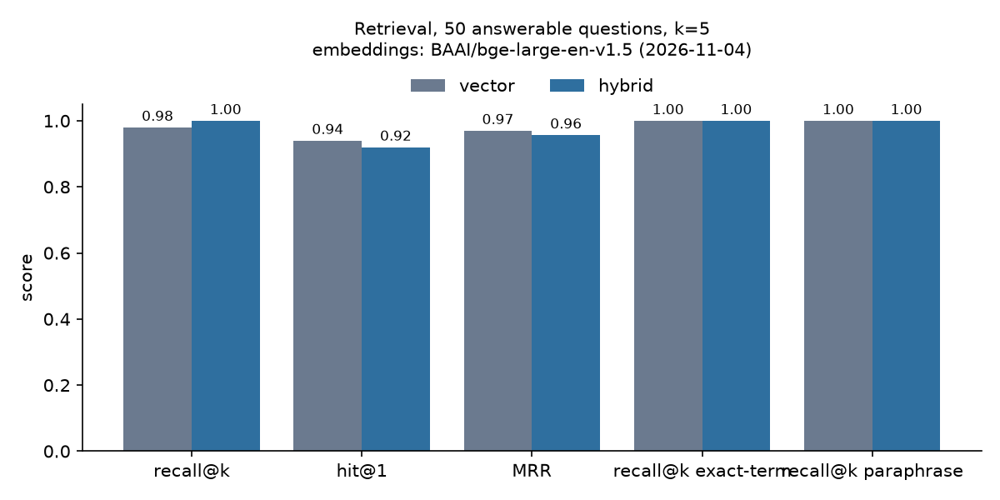
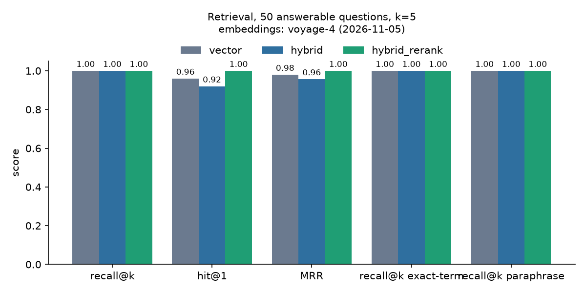
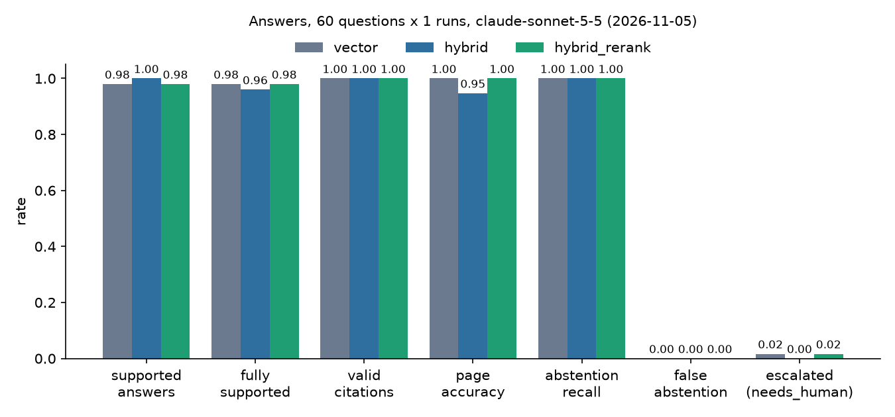
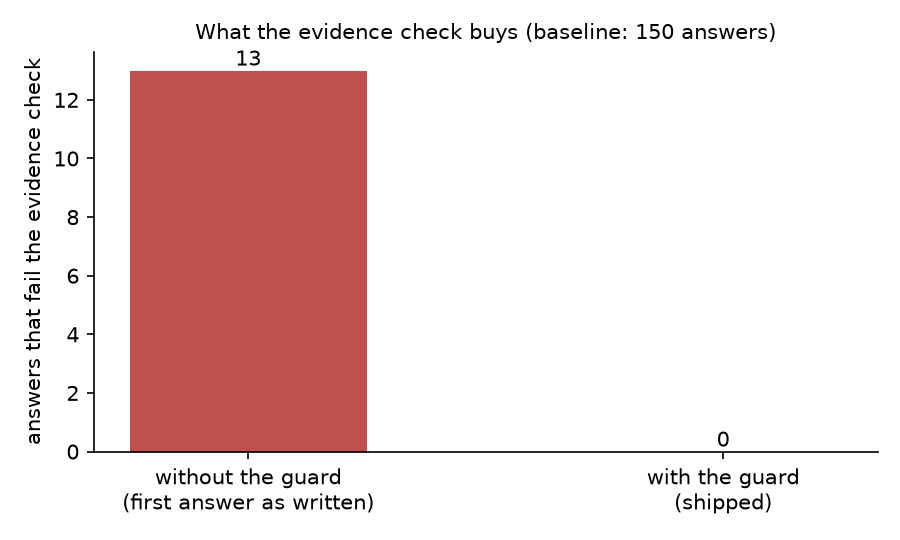

# evidence-rag

[](https://github.com/Zenith10-fck/evidence-rag/actions/workflows/ci.yml)

A REST API that answers questions about a business's documents (text and PDF) and **proves every
answer**: each answer must quote the exact text it relies on, code checks that the quote really
exists in the retrieved text, and anything that cannot prove itself is refused or sent to a person.

Reference build on synthetic data (a made-up online shop, "Harbor Goods"). Not a client project.

**Status (2026-11-05):** built, tested (no API keys needed for the tests) and measured: 60
questions x 3 retrieval modes through the real pipeline with Claude Sonnet 5.5 and Voyage. **0
answers shipped without proof**; without the evidence check, 13 of 150 first answers would have.
One run per mode (budget), so run-to-run variation is not measured. Every number is in
[results.json](results.json); every miss is listed below.

## How an answer is proven

```
POST /documents      (text)  ─┐
POST /documents/pdf  (file)  ─┴► chunks (one page each) ─► embeddings ─► Postgres + pgvector + full-text

POST /ask ─► retrieve top-k   (vector | hybrid | hybrid + rerank)
          ─► Claude answers in a forced JSON schema: answer, citations[{doc_id, chunk_id, quote}], abstained
          ─► schema check (pydantic)
          ─► evidence check, in code:
               every quote must be an exact substring of a chunk that was retrieved for THIS question
               every number in the answer must appear in a cited quote
                 │ fails ─► one retry with the exact errors ─► check again
                 ▼ fails again
              needs_human   (no answer text is returned as fact)
          ─► page number and document title are copied from the stored chunk, never from the model
```

| Status | Meaning |
|---|---|
| `answered` | every citation was found verbatim in the retrieved text |
| `abstained` | the documents do not contain the answer: "Not in the documents." |
| `needs_human` | the answer could not prove itself after one retry; the errors are returned instead |

The model's output is treated as untrusted input. The prompt asks for exact quotes; the code enforces
them. See [docs/ARCHITECTURE.md](docs/ARCHITECTURE.md) for the exact rules and their limits.

## Run it

Needs Docker, an Anthropic key and a Voyage key.

```bash
cp .env.example .env            # Windows: copy .env.example .env ; then fill the values
# set API_KEY (any long random string), POSTGRES_PASSWORD, ANTHROPIC_API_KEY, VOYAGE_API_KEY
docker compose up --build       # Postgres + pgvector and the API, live mode
```

The API is on <http://localhost:8000> (`/ui` for the page, `/docs` for the OpenAPI docs). `GET /ready`
returns 200 only when the database answers; `GET /health` only says the process is alive. Load the
documents once with the ingest script (below), then ask questions in `/ui` with your `API_KEY`.

Operating notes (limits, logs, backups, what is not covered): [docs/OPERATIONS.md](docs/OPERATIONS.md).

### Without Docker for the API (development)

```bash
copy .env.example .env          # Linux/macOS: cp .env.example .env ; then fill the values
docker compose up -d db
uv sync --extra local           # free local embeddings (CPU); skip if you set VOYAGE_API_KEY
uv run --extra local python scripts/ingest_corpus.py
uv run --extra local uvicorn app.main:app --reload
```

Then <http://localhost:8000/ui> with the `API_KEY` from `.env`.

- Without any key, ingest and `/retrieve` (retrieval only) work with the local embedding model.
- `/ask` needs `ANTHROPIC_API_KEY`; without it, it returns 503 with a clear message.
- `hybrid_rerank` needs `VOYAGE_API_KEY` (the reranker is an API). Without it the mode falls back to
  hybrid order and the response says `"rerank": "skipped"`.

## API

| Route | What |
|---|---|
| `GET /health` | liveness: the process is up |
| `GET /ready` | readiness: 200 only if the database answers, else 503 |
| `POST /documents` | add or update a text document (idempotent by content hash) |
| `POST /documents/pdf` | add or update a PDF; text is extracted per page, each chunk keeps its page |
| `GET /documents` | list documents in a collection |
| `POST /ask` | answer with checked citations |
| `POST /retrieve` | the chunks retrieval returns, without calling Claude |
| `GET /ui` | a small page: ask, see the status, the quote highlighted in its source with page |

All routes except `/health` and `/ui` need the `X-API-Key` header (compared in constant time).
Every document belongs to a `collection_id`; every query filters by it in SQL, and a test proves one
collection never sees another. Details and examples: [docs/API.md](docs/API.md) and `/docs`.

## Measured results

<!-- results:start -->

Generated by `scripts/update_readme.py` from [results.json](results.json). Do not edit by hand.

### Retrieval

Embeddings `BAAI/bge-large-en-v1.5`, measured 2026-11-04: 50 answerable questions, k = 5.

| Mode | recall@k | hit@1 | MRR | misses |
|---|---|---|---|---|
| vector | 0.98 | 0.94 | 0.97 | Q049 |
| hybrid | 1 | 0.92 | 0.9567 | none |
| hybrid + rerank | not measured: no VOYAGE_API_KEY (the reranker is an API) | | | |



Embeddings `voyage-4`, measured 2026-11-05: 50 answerable questions, k = 5, reranker `rerank-3`.

| Mode | recall@k | hit@1 | MRR | misses |
|---|---|---|---|---|
| vector | 1 | 0.96 | 0.98 | none |
| hybrid | 1 | 0.92 | 0.9567 | none |
| hybrid + rerank | 1 | 1 | 1 | none |



### Answers

Measured 2026-11-05 with `claude-sonnet-5-5` (effort `low`), embeddings `voyage-4`, k = 5, 60 questions, 1 run(s) per mode. Cost uses the list price in results.json (claude-api skill model table, cached 2026-10-06 (list price, no caching discount)).

Only 1 run per mode (docs/MEASUREMENT.md plans 3): the run was limited to a 1.50 USD budget. Run-to-run variation is therefore not measured.

| | vector | hybrid | hybrid + rerank |
|---|---|---|---|
| questions answered by the pipeline | 60 of 60 | 60 of 60 | 60 of 60 |
| supported answers (cited an expected quote) | 98.0% | 100.0% | 98.0% |
| fully supported (an expected quote from every expected document) | 98.0% | 96.0% | 98.0% |
| key facts in the answer | 98.0% | 98.0% | 98.0% |
| valid citations (all attempts) | 100.0% | 100.0% | 100.0% |
| page accuracy (PDF questions) | 100.0% | 94.7% | 100.0% |
| **answers shipped without proof** | **0** | **0** | **0** |
| correct refusals (unanswerable) | 100.0% | 100.0% | 100.0% |
| false refusals (answerable) | 0.0% | 0.0% | 0.0% |
| escalated (needs_human) | 1.7% | 0.0% | 1.7% |
| needed the one retry | 6.7% | 8.3% | 6.7% |
| retry fixed it | 75.0% | 100.0% | 75.0% |
| latency p50 / p95 (s) | 2.591 / 5.69 | 2.95 / 53.05 | 52.43 / 57.63 |
| cost, total (USD) | 0.3766 | 0.3959 | 0.3811 |
| cost per question (USD) | 0.0063 | 0.0066 | 0.0064 |

**Baseline without the evidence check:** 0 of 150 answers (0.0%) contained a quote that is not in any retrieved chunk; 0 had no citation. Counting every reason the check rejects (also numbers in the answer that no quote contains), 13 of 150 first answers (8.7%) would have shipped without proof. With the check, the number shipped is the row in bold above. (first attempt of each run-1 answer as the model wrote it, before the evidence check and retry (same prompt, same model); all modes.)

Supported answers by tag:

| | vector | hybrid | hybrid + rerank |
|---|---|---|---|
| exact-term | 91.7% (n=12) | 100.0% (n=12) | 91.7% (n=12) |
| paraphrase | 100.0% (n=9) | 100.0% (n=9) | 100.0% (n=9) |





#### Every miss (4)

| Question | Mode | What went wrong |
|---|---|---|
| Q029 | hybrid + rerank | needs_human after retry: the number 12,000 in the answer does not appear in any cited quote |
| Q029 | vector | needs_human after retry: the number 12,000 in the answer does not appear in any cited quote |
| Q041 | hybrid | partial answer: no expected quote from supplier-terms-trailworks |
| Q045 | hybrid | partial answer: no expected quote from warranty |

<!-- results:end -->

### Reading the numbers

Written by hand after the run; the numbers it mentions are the ones in the generated block above.

- **The guard did its job.** No answer reached the caller without proof, in any mode. None of the
  150 first answers invented a quote: every quote Claude wrote was found in the retrieved text. The
  13 first answers that the check rejected were all caught by the number rule: the answer
  contained a number that no cited quote contains (a date, a number repeated from the question, or
  a figure the quotes did not back). The one retry fixed 11 of the 13.
- **Refusals were right.** All 10 questions the documents cannot answer were refused, in every
  mode, and no answerable question was refused.
- **Retrieval modes barely differ on this set.** With Voyage embeddings, recall@5 is at the
  ceiling for every mode; the reranker put an expected document first for every question (hit@1),
  where hybrid without it was lowest. In the answers, the modes differ by one or two questions out
  of 60 in a single run, which is too small to call a winner. A larger or harder corpus is needed
  to show what hybrid search and reranking buy.
- **The one kind of escalation is a false alarm.** Q029 asks about a 12,000 USD purchase order; the
  answer was correct but repeated 12,000 from the question, and the number rule rejected it twice.
  The rule was kept strict on purpose: letting numbers from the question through would also let a
  wrong confirmation pass ("yes, 45 days" when the document says 30).
- **Partial answers on two-document questions.** In hybrid mode, Q041 and Q045 cited only one of
  the two documents they need (Q041 said the Trailworks terms were not in the excerpts, although
  other modes found them). These count as supported (an expected quote was cited) but not as
  fully supported.
- **Latency here is not product latency.** The Voyage account used has no payment method, so it
  is limited to a few requests per minute, and the client waits for the limit. That wait is inside
  the measured latency of hybrid + rerank (an extra API call per question) and of the questions
  whose query embedding was not cached. Vector mode is the closest to the real model + retrieval
  time.

Changes made after the first look at the results (the original numbers are still reported):

| Change | Why | Before | After |
|---|---|---|---|
| Added "fully supported" (an expected quote from every expected document) | "supported" needs only one expected quote, which hides half answers on two-document questions | hybrid supported 100.0% | hybrid fully supported 96.0% |
| Partial answers listed as misses | so the miss list shows them | 2 misses | 4 misses |
| Baseline also counts first answers rejected for any reason | "invented quote" alone was 0 and hid what the check catches | 0 of 150 | 13 of 150 |

No prompt, answer key or evidence rule was changed after seeing the results.

## Design choices

| Choice | Why |
|---|---|
| Chunks never cross a page; one-sentence overlap | a citation points to exactly one page; a two-sentence quote is always whole inside some chunk (tested on every answer-key quote) |
| pypdf for PDF text | pure Python, works the same on Windows, Linux and a slim image; text PDFs only, scans rejected with a clear message |
| Postgres + pgvector, HNSW index | one database for vectors, full-text and metadata; HNSW needs no training step; `hnsw.iterative_scan` keeps filtered queries returning k rows |
| Hybrid = vector + Postgres full-text, merged with reciprocal rank fusion | full-text catches exact terms (rates, codes, limits); RRF needs no score tuning |
| Structured outputs (`output_config.format`) plus pydantic | the API constrains the shape; the code still validates it, and a bad shape counts as an evidence failure |
| Evidence check: exact substring, only whitespace normalised | strict on purpose; PDF line breaks are handled, paraphrases are rejected |
| Page and title copied from the stored chunk | the model is never asked for a page, so it cannot invent one |
| One retry, then `needs_human` | a second chance fixes copy errors; more retries would hide a real problem |
| Settings named `ANSWER_*`, Anthropic base URL pinned | a stray `CLAUDE_EFFORT` or `ANTHROPIC_BASE_URL` in the shell cannot change the run |
| Local embeddings as an optional extra | retrieval can be built and measured for free; Voyage API is used when its key is set |

## Limits

- 60 questions on 20 synthetic documents, one language, text-based PDFs only. The numbers describe
  this set, not every RAG system.
- The evidence check proves that quotes exist and that numbers in the answer are quoted. It does
  not prove that every sentence of the answer follows from the quotes; a wrong sentence without a
  number can pass. The measurement reports how often an expected quote was cited.
- Hyphenation or ligatures in a PDF would make an exact quote fail (none in this corpus).
- One run per mode (a 1.50 USD budget); MEASUREMENT.md plans three. Differences of one or two
  questions between modes are within what a second run could change.
- Retrieval is near the ceiling on this small corpus (95 chunks), so it does not separate the
  modes well.
- The number rule can escalate a correct answer that repeats a number from the question (Q029).
- Latency includes client-side waits for the Voyage free-tier rate limit.

## Project layout

```
app/        FastAPI app: config, chunking, PDF, embeddings, store, retrieval, rerank, answer,
            evidence check, guards, usage limits, logs, /ui page
scripts/    make_corpus, make_pdfs, ingest_corpus, eval_retrieval, measure, plot_results
data/       synthetic corpus (16 markdown + 4 PDF), 60 questions with answer keys
tests/      tests: chunking, PDF, evidence check, retry path (mocked Claude), API guards,
            collection isolation, usage limits, answer keys verbatim in the corpus
docs/       architecture, API, operations, corpus spec, measurement definitions
```

Start with [docs/OPERATIONS.md](docs/OPERATIONS.md).

## Development

```bash
uv run pytest            # needs the db for database tests: docker compose up -d db
uv run ruff check .
uv run python scripts/make_corpus.py && uv run python scripts/make_pdfs.py   # repeatable
```

Measuring (the Claude run costs money; `--estimate` calls nothing):

```bash
uv run python scripts/eval_retrieval.py                 # retrieval only
uv run python scripts/measure.py --estimate
uv run python scripts/measure.py --runs 1 --yes --budget-usd 1.50
uv run python scripts/plot_results.py && uv run python scripts/update_readme.py
```

With a Voyage account that has no payment method, set `VOYAGE_RPM=2` and `VOYAGE_TPM=8000`
so the client stays under its rate limit.

Stack: Python 3.12, uv, FastAPI, pydantic v2, Postgres 16 + pgvector 0.8.4, Voyage AI (embeddings,
reranker) or a local sentence-transformers model, Anthropic Python SDK (Claude Sonnet 5.5), pypdf,
reportlab (test PDFs), pytest, ruff, Docker, GitHub Actions. No LangChain or LlamaIndex.

## License

MIT, see [LICENSE](LICENSE).
